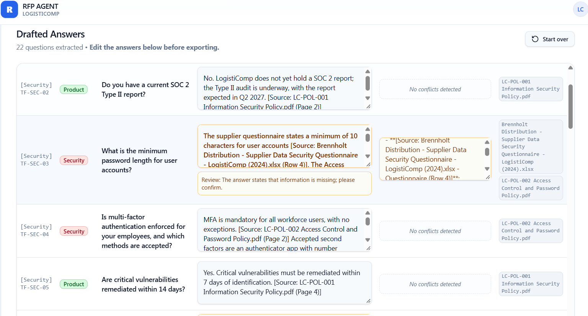
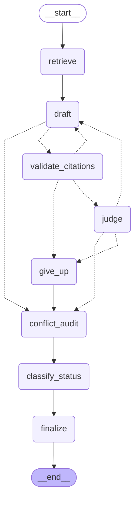
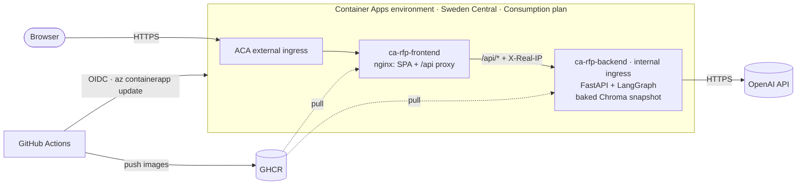

# RFP Answering Agent

An AI agent that fills in RFP and security questionnaires (Excel or PDF) from a company's policy PDFs and past answers. Every answer is cited, checked, and sent to a human when the agent is not sure.

**[Live demo](https://ca-rfp-frontend.lemonmushroom-68fd4a9a.swedencentral.azurecontainerapps.io/)** · [Evaluation](#evaluation) · [Architecture](#architecture) · [Engineering notes](#engineering-notes) · [Run it](#run-it)


| 89.9 / 100 | 6 / 6 | 44 / 46 | 273 tests |
|:---:|:---:|:---:|:---:|
| answer score on a 52-question eval set (88.7 on the held-out split; one run) | unanswerable questions refused or sent to a human, none guessed | answerable questions whose supporting fact is retrieved | run before every automatic deploy to Azure |

**How it works:** for each question, retrieve → draft with inline citations → check the citations in code → LLM judge → redraft (max 3 drafts) or flag for human review. The output is the original workbook with answers, sources and a status colour per row.

**Stack:** Python 3.12, FastAPI, LangGraph, LangChain, Chroma, OpenAI (`gpt-6-luna` default, `gpt-4o-mini` selectable; `text-embedding-3-small`), LlamaParse, LangSmith tracing (optional), React/TanStack, nginx, Docker Compose, Azure Container Apps, GHCR, GitHub Actions (CI/CD, OIDC).

Demo data: LogistiComp is a fictional company; all documents in `Backend/data` were written for this demo.

## Live demo

**https://ca-rfp-frontend.lemonmushroom-68fd4a9a.swedencentral.azurecontainerapps.io/**

- **RFP Solver:** upload the fictional customer questionnaire [Thornvale Foods - Security and Service Questionnaire.xlsx](eval/Thornvale%20Foods%20-%20Security%20and%20Service%20Questionnaire.xlsx) (22 questions) or the [Thornvale PDF RFP](eval/Thornvale%20Foods%20-%20RFP%20Cloud%20WMS.pdf), review the answers, download the filled workbook.
- **Accuracy Evaluator:** upload [eval/eval_set_v2.xlsx](eval/eval_set_v2.xlsx) (52 questions with expected answers); the LLM judge scores every answer.
- **Knowledge Base:** the 12 fictional LogistiComp documents the answers come from.

What to expect:
- **Cold start:** the app scales to zero, so the first request after a quiet period takes a few seconds.
- **Run time:** about 45 s for the 22-question Thornvale questionnaire; the 52-question evaluation takes about 1.5 minutes. Every question goes through retrieval, drafting and judging.
- **Demo limits:** up to 55 questions, 5 MB, 20 PDF pages and 5 runs per hour per visitor (100 per day overall). One model: gpt-6-luna.
- **Read-only knowledge base:** upload and delete are disabled.



## Architecture

### RFP graph
`extract_node` reads questions (Excel: question/ID/dropdown column detection; PDF: LLM extraction into `ExtractedQuestion`), then fans out with `Send`, one `answer_node` per question (concurrency 5). Each `answer_node` runs the question subgraph inside one try/except, so a failing question becomes `status=error` instead of failing the whole run. `report_node` orders the `Answer` objects; `excel_io` writes them back to their original sheet and row.


### Question subgraph
Dotted arrows are router decisions. A "not found" draft skips validation and judge. Invalid citations or a judge rejection send the draft back with feedback, up to `MAX_REVISIONS = 2` (max 3 drafts); after that `give_up` keeps the last draft for a human. Every path runs the conflict audit and the dropdown classifier before `finalize` sets the status.



Both diagrams are generated from the compiled graphs with `get_graph().draw_mermaid()`.

## How it works

- **Retrieval.** Chroma, plain similarity search, k=5 (`RETRIEVAL_SEARCH_TYPE`; MMR stays selectable for comparison). The knowledge base mixes long policy PDFs with short past-RFP rows. `eval/retrieval_eval.py` checks, without LLM calls, whether the chunks holding each question's expected fact are retrieved: on the demo knowledge base similarity k=5 finds them for 44 of 46 questions, MMR (λ=0.7) for 40, with the same number of past-RFP rows (1.9 per question; EV-08's fact phrase was corrected to accept the Section 8 wording). MMR's diversity step dropped policy chunks ranked 4–5 in favour of less relevant ones.
- **Analyst draft.** A persona per category (Security/Tech/Product) writes an answer with inline `[Source: <label> (Page N | Row N)]` citations. The LLM returns `AnalystDraft` (`answer_text`, then `answer_found`). Code builds the full `Answer` (IDs, sheet, row, sources, status), so the model can't change bookkeeping fields.
- **Citation validation in code.** `parse_citations` pulls the cited labels out, and `check_citations` compares them with the chunks that were actually retrieved. No citations, an unknown file or a location that wasn't retrieved → redraft with the list of allowed labels. No LLM involved.
- **LLM judge.** Sees the question, the retrieved context and the draft. It writes `reasoning` before `has_hallucination` and `feedback`. It is told how to read past-RFP rows ("Yes" supports the claim in that row's question, "No" contradicts it, guidance text is not evidence). Absence vs. inference rule: "the context does not specify X" is valid, while "X is implied to be 8" is a hallucination unless the context says so.
- **Redraft.** The analyst gets its previous answer plus the judge's feedback and is told to fix only the flagged claims. Supported content stays.
- **`needs_review` instead of discarding.** When revisions run out, the last draft is kept with a `review_note` (last judge feedback or invalid citations) and shows yellow. Before this change it was replaced by the "not found" message. Answers that are partly supported and partly "not found" are flagged the same way.
- **Not found, decided in code.** The draft also returns `answer_found`; when it is false, code replaces the text with the standard "not found" message (status `not_found`) and keeps the model's wording in the review note. gpt-6-luna often words a refusal freely instead ("X is not mentioned in the available information"), which used to pass as a normal answer. `finalize` therefore checks the answer, citations removed, against a short list of absence phrases ("not mentioned / stated / specified", "does not mention", "no information", …) and marks it `needs_review` with a note, so a human confirms. On eval set v2 every unanswerable question then reached a human; about two answers per run are flagged needlessly (a side caveat in a complete answer).
- **Status enum.** `answered | not_found | needs_review | error` is set by code in `finalize` and the error fallback. It drives the UI and Excel colours. A human edit in the UI sets `answered`.
- **Ingestion dedup.** Files are identified by filename and versioned by a SHA-256 of their bytes, stored in chunk metadata together with `chunk_count`. Same hash and complete → skip. Same hash but incomplete → re-ingest. New hash → ingest the new version first and delete the old chunks only after that succeeds, so a failed replace never loses the old version. Startup and upload use the same `ingest()`.

## Evaluation

### Demo knowledge base (LogistiComp)

**Eval set v2.** 52 questions written for the fictional documents (`eval/eval_set_v2.xlsx`), each with an expected answer, expected status, a type (answerable, nuanced, deduction, partial, stale/policy conflict, unanswerable, leak check, past-RFP only), a dev (33) / held-out (19) split and the reference document. 6 are unanswerable. `eval/score_report.py` scores unanswerable rows in code (100 if the agent marks them `not_found` or `needs_review`), the rest with the LLM judge, and also counts wrongful refusals and leaks (other customers' names in answers, other customers' files in citations).

**Judge.** gpt-6-luna, reasoning effort low (an alias with no dated snapshot). It returns `reasoning`, then `generated_verdict` (the answer's own yes/no reply to the question), then a score; code caps the score at 20 when the verdict contradicts an expected Yes/No. Validated by re-judging the same stored answers with `eval/rejudge.py` instead of trusting one run: gpt-4o-mini filled the verdict with "agrees with expected" and produced 8 false caps on 52 answers, so it was dropped as judge; after clarifying the field, gpt-6-luna capped only real contradictions ("not within 6 months", "not 10"). Judging the same answers twice differed by 0.8 points overall (max 10 per row), well below the run-to-run noise of the agent.

**Retrieval.** `eval/retrieval_eval.py` checks, without LLM calls, whether the chunks holding each question's expected fact are retrieved. Switching from MMR (λ=0.7) to plain similarity k=5 raised fact recall from 40 to 44 of 46 answerable questions, with the same number of past-RFP rows per question.

**Current scores** (similarity k=5, judge gpt-6-luna; mean (min–max) over runs). Unanswerable rows count as handled if the agent marks them `not_found` or `needs_review`.

| Agent | Runs | Overall | dev | held-out | Unanswerable handled | Answerable flagged for review | Customer name in answer text | Cost / run |
|---|---|---|---|---|---|---|---|---|
| gpt-4o-mini | 2 | 87.3 (86.9–87.7) | 87.7 | 86.7 | 6/6 | 0 | 1 row in 1 of 2 runs | $0.048 |
| gpt-6-luna + absence safety net (default) | 1 | **89.9** | 90.6 | 88.7 | 6/6 (3 not_found, 3 needs_review) | 9 (6 expected partials, 1 useful, 2 false alarms) | 0 | $0.035 |

| Type (dev n / held-out n) | gpt-4o-mini dev / held-out | gpt-6-luna dev / held-out |
|---|---|---|
| answerable (6/5) | 95.0 / 85.0 | 92.5 / 72.0 |
| nuanced (5/3) | 84.0 / 68.3 | 81.0 / 81.7 |
| stale conflict (1/1) | 95.0 / 85.0 | 100 / 85.0 |
| deduction (5/3) | 82.5 / 100 | 96.0 / 100 |
| partial (4/2) | 96.2 / 77.5 | 92.5 / 97.5 |
| policy conflict (1/0) | 40.0 / – | 100 / – |
| unanswerable (4/2) | 100 / 100 | 100 / 100 |
| leak check (2/1) | 40.0 / 77.5 | 45.0 / 100 |
| past-RFP only (5/2) | 98.0 / 100 | 98.0 / 100 |

gpt-6-luna is the default: higher score, cheaper, no customer names in answers, and every unanswerable question reaches a human. Caveats: one gpt-6-luna run (run-to-run noise is a few points), and the gpt-4o-mini runs predate the absence safety net. Full log: [eval/RESULTS.md](eval/RESULTS.md).

### Original private knowledge base

*The numbers in this subsection were measured on the original private knowledge base and eval set, not on the LogistiComp demo data.*

**Method.** An eval set of 47 questions with expected answers. The evaluator runs the agent and has an LLM judge score each answer 0–100 against the expected one (dropdown columns are compared as exact category matches). Rows whose expected answer is "not found" are skipped, so n=33 are scored. A repeat run with nothing changed differed by ~5 points, so a setting is judged on the average of ≥2 runs, not on one run.

**Results.** Full run log: [eval/RESULTS.md](eval/RESULTS.md).
- Data mattered more than prompts. Adding two past-RFP answer spreadsheets to the 18 policy PDFs raised the score from 50.6 to 73.8; rows whose answer comes from those spreadsheets went from 27.2 to 72.5. It also exposed leaks: another customer's name was copied into an answer, and 20 citations named customer files. Safeguards are not implemented yet (see Roadmap).
- The answer-quality changes described in "How it works" (judge sees the question, reasoning before verdict, citation validation, `needs_review`, λ=0.7) averaged 74.1 over two runs against 71.5 before: +2.6, inside the ±5 noise. Individual wins repeated: the password-length question went from 0 to 90 in both runs.
- One prompt change looked neutral by score but was a regression; see "A flat score hiding a regression" below.

**Known limitations.**
- Expected answers are old agent outputs that nobody has reviewed (several rows are known to be wrong), so the score measures agreement with the agent's first version, not accuracy.
- Rows with an expected "not found" are skipped, so the evaluator can't see an agent that answers questions it shouldn't.
- One judge model, and the private eval set is small.

## Deployment on Azure

### Architecture on Azure



- **Two container apps** in Sweden Central on the Consumption plan, both scaling to zero with at most 1 replica.
- **Frontend:** nginx serves the SPA and proxies `/api/*` to the backend, so the browser only ever talks to one origin.
- **Backend:** internal ingress only, so it's unreachable from the internet.
- **Knowledge base:** baked into the backend image as a Chroma snapshot, so a new replica starts with no parsing or embedding calls.
- **Probes:** HTTP startup, readiness and liveness probes on `/api/health`.
- **Images:** public images in GitHub Container Registry, tagged with the 7-character commit SHA.

### CI/CD

`.github/workflows/ci.yml`. On every push and pull request, `checks` runs and both images are built. Pushing to GHCR and deploying happen only on main, for a push or a manual run (`workflow_dispatch`):

1. **checks:** ruff + pytest, with no LLM or network calls.
2. **docker:** build both images with a GitHub Actions layer cache, after `checks` passes. On main they're pushed to GHCR; elsewhere they're only built.
3. **deploy:** `azure/login` via OIDC, then `az containerapp update` for the backend, then the frontend. Each step fails unless the provisioning state is `Succeeded`.
4. **wait:** both apps must reach a ready latest revision running the image tagged with this commit.
5. **smoke test:** through the public URL, `/api/health` must return 200 (with retries for a cold start), and `/api/config` must report `demo_mode: true`.

Deploys never overlap (concurrency group). No Azure secret is stored in GitHub:
- the OIDC federated credential is bound to the main branch;
- GHCR uses the built-in `GITHUB_TOKEN`;
- the service principal has Contributor on the app's resource group only.

### Cost safeguards

| Safeguard | Effect |
|---|---|
| Scale to zero (Consumption plan) | No compute cost while idle; the price is a few seconds of cold start |
| Max 1 replica per app | Caps compute; keeps the in-memory rate limiter consistent |
| Demo limits (`DEMO_MODE`) | 55 questions, 5 MB, 20 PDF pages, one model, 5 runs/hour per IP, 100 runs/day; read-only knowledge base (no LlamaParse or embedding cost) |
| OpenAI project budget | The demo key belongs to its own OpenAI project, which has a budget |
| Azure budget alert | Email alert when Azure spend passes the budget (notification only; it doesn't stop resources) |
| GHCR | Free public images instead of a paid container registry |

## Engineering notes

### Agent and evaluation

- **A docstring sent to the LLM.** A developer docstring on the Pydantic draft model became the JSON-schema description the model saw. On one question (password length), drafts over-claimed "minimum 8" in 26/26 runs with the docstring and 0/30 without it (runs interleaved). Fix: a comment instead of a docstring, plus snapshot tests over prompts and LLM-facing schemas (`tests/prompt_snapshots/`), so any byte change to what the model sees shows up in review.
- **Judge contradicting itself.** With the verdict field first, the judge flagged a supported claim as unsupported, and its feedback quoted the context text that supports it. Fix: a `reasoning` field before `has_hallucination`, so the verdict follows the analysis. After the change the same answer was approved.
- **MMR dropping the answer.** The password-length question kept failing. A retrieval diagnostic using the full question text showed the answer chunks at similarity ranks 3–4, removed by MMR λ=0.5 in favour of near-duplicate past-RFP rows. First fix: λ=0.7, checked offline first (both kinds of source returned), then in the eval, together with the judge changes: the question went from 0 to 90 in both runs. Later, on the demo knowledge base, a fact-recall check over the whole eval set (`eval/retrieval_eval.py`) showed MMR at λ=0.7 still dropping facts: similarity k=5 recall 44/46 vs MMR λ=0.7 40/46, at the same past-RFP count (after correcting EV-08's fact phrase). Retrieval now uses plain similarity.
- **A flat score hiding a regression.** A prompt change told the analyst to use the "not found" message only when nothing in the context was relevant. "Not found" answers fell from about 14 to 2 and the score stayed flat, which looked like a win. Checking the rows showed that about 10 of the 14 unanswerable questions now got padded partial answers. The score couldn't see it because the evaluator skips rows whose expected answer is "not found". Fix: reverted the prompt and handled partial answers in code (`is_partial_fail_text` → `needs_review` with a note). Unanswerable rows are now scored in code (`eval/score_report.py`), so this kind of regression shows up in the score.
- **Evaluating the evaluator.** A cap meant to catch answers that contradict an expected Yes/No fired on correct answers. Re-judging the same 52 stored answers with `eval/rejudge.py` (no agent re-run) showed gpt-4o-mini filling `generated_verdict` with "agrees with the expected answer" instead of the answer's own yes/no: 8 false caps, each turning a correct answer into 20. gpt-6-luna, with the field described as "the answer's own yes/no reply, ignoring the expected answer", capped only real contradictions. The same answers judged twice differed by 0.8 points overall.
- **A wrong answer caused by retrieval, not reasoning.** EV-45 ("How quickly must your suppliers notify you of a security incident?") kept getting "48 hours". The supplier clause (24 hours) was the 5th most similar chunk, but MMR swapped it for a neighbouring chunk, and the other four chunks were all about LogistiComp notifying its own customers within 48 hours. The model answered faithfully from what it was given. With plain similarity retrieval EV-45 scored 100 in all 5 runs (20 before).
- **Results from a stale backend.** One eval run showed the old judge's behaviour after the code had changed: a second uvicorn process on the same port (Windows allows it) was still serving code from an hour earlier. Every evaluated file now has a "Run info" sheet with agent model, judge model and settings, timestamp, and the git commit and start time read when the backend loaded its code, so a stale server shows up in the file.

### Deployment

- **A blocked event loop.** `/api/health` and every other request hung during an RFP run. Cause: the synchronous `rfp_graph.invoke` ran inside `async def` endpoints. A test with a fake 1 s graph showed health returning after 1.26 s instead of right away. Fix: graph, Excel and ingestion work run in worker threads (`asyncio.to_thread`); the test fails if that step is removed. Starlette's `run_in_threadpool` was tried first, but under `nest_asyncio` it left non-daemon worker threads behind, and the test process never exited. On Azure, the HTTP liveness/readiness probes keep answering every 5 s during a run.
- **Re-ingesting on every cold start.** Scale to zero with no persistent volume means every new replica starts with an empty vector store. Startup would then re-parse and re-embed all 12 documents (LlamaParse + OpenAI calls, keys required), and uvicorn opens its port only after that work. Fix: a Chroma snapshot (241 chunks, about 4 MB) is committed and baked into the image, so the startup hash check skips every file. `chromadb` is pinned to the snapshot's version, and a test fails if `Backend/data` and the snapshot drift apart.
- **The 240 s ingress limit.** Container Apps ingress ends HTTP requests after 240 s, and an evaluation is one long request. The 52-question eval set took ~186 s, 76 s of it judge calls made one at a time. Fix: judge calls run in parallel (5, like the graph) and results stay in row order; a test fails if they run sequentially. The run now takes about 96 s (from ~186 s). Longer files need background jobs (Roadmap).
- **Real client IP behind Azure proxies.** The per-IP rate limit has to see the visitor, not a proxy. On a cold start the backend logged an Azure-internal proxy address as the client: X-Forwarded-For can end with an extra Azure hop, and nginx took the rightmost entry. Fix: nginx `realip` trusts the private address ranges, with recursive mode on. It walks X-Forwarded-For from the right, skips trusted hops, and uses the first public address. Entries a client could fake sit to the left of its real IP and are never reached. The backend reads only the `X-Real-IP` header that nginx sets, and the nginx access log shows the raw header for checking.
- **OIDC subject with immutable IDs.** The first deploy failed at `azure/login` with `AADSTS700213: No matching federated identity record`. Evidence: the login step prints the subject claim GitHub presented, and it contained numeric IDs after the owner and repository names (`repo:<owner>@<id>/<repo>@<id>:ref:refs/heads/main`), while the federated credential expected names only. GitHub includes immutable IDs so a renamed or re-registered account or repository can't match an old trust rule. Fix: set the federated credential's subject to the exact presented claim.

## Run it

### Run with Docker

Needs Docker Desktop and a root `.env` with `OPENAI_API_KEY` and `LLAMA_CLOUD_API_KEY` (`NAME=value` lines, no quotes).

```powershell
docker compose up --build   # frontend localhost:8080, backend localhost:8000 (/docs)
docker compose down         # stop
```

The frontend's nginx proxies `/api` to the backend (`BACKEND_URL`). The backend image contains the knowledge-base snapshot, but compose mounts `Backend/data` and `Backend/chroma_db` from the host, so your local store is used: new files in `data/` are ingested on startup, unchanged ones skipped. Try demo mode locally with `$env:DEMO_MODE="true"; docker compose up --build`; limits can be overridden the same way (e.g. `MAX_QUESTIONS`, `RATE_LIMIT_PER_HOUR`). Don't run `start.bat` and compose at the same time (same ports, same Chroma store).

### Run locally

Windows, PowerShell, Python 3.12, Node.

```powershell
python -m venv venv; .\venv\Scripts\activate
pip install -r Backend/requirements.txt
cd Frontend; npm install; cd ..
# root .env: OPENAI_API_KEY, LLAMA_CLOUD_API_KEY
# optional LangSmith tracing: LANGSMITH_TRACING=true, LANGSMITH_API_KEY, LANGSMITH_PROJECT
#   LANGSMITH_ENDPOINT=https://eu.api.smith.langchain.com for EU accounts (must match the key's region)
#   (smoke.py, run_rfp.py, compare_excel.py switch tracing off)
.\start.bat                          # backend :8000, frontend :8080; ingests new files in Backend/data/ on startup
.\check.ps1                          # ruff (F rules) + pytest, no LLM or network calls
.\venv\Scripts\python eval\smoke.py --step 6 --model gpt-6-luna   # real LLM calls (<$0.01) on eval/fail_test.xlsx, PASS/FAIL per eval/SMOKE.md
                                     # smoke.py defaults to gpt-4o-mini (keeps SMOKE.md baselines); --model gpt-6-luna tests the app default
```

Other tools: `eval\run_rfp.py <file>` (any RFP through the pipeline, prints the agent log), `eval\compare_excel.py` (export vs. recorded baseline, cell by cell).

## Project layout

```
LICENSE
.github/workflows/ci.yml   CI/CD: ruff + pytest, images to GHCR, deploy to Azure, smoke test
docker-compose.yml   backend + frontend services
Backend/Dockerfile   python:3.12-slim, uvicorn on :8000, baked knowledge-base snapshot
Backend/kb_snapshot/ Chroma snapshot of Backend/data (drift test in tests/test_kb_snapshot.py)
Backend/app/
  main.py         FastAPI app, startup ingest, CORS
  api.py          endpoints (analyze, export edits, upload, evaluate, health, config)
  limits.py       demo limits, model allow-list, per-IP and daily run limiter
  config.py       paths, retrieval params, FAIL_MSG, pricing, demo settings from env
  store.py        lazy Chroma singleton
  ingestion.py    loaders + shared ingest() with hash dedup
  excel_io.py     column detection, dropdowns, read_sheets, formatted writer
  evaluation.py   LLM judge + categorical eval
  agent/
    prompts.py    all prompt builders (pinned by snapshot tests)
    schemas.py    pydantic models, Status enum, graph states
    nodes.py      node functions + routers
    graph.py      question subgraph, rfp graph
Backend/tests/    pytest: pure functions, citations, ingest dedup on a temp Chroma, prompt snapshots
eval/             eval sets, smoke test, debug runner, Excel comparison, run files, RESULTS.md
  score_report.py    markdown report for evaluated runs (scores, refusals, review flags, leaks)
  rejudge.py         re-judge stored answers with another judge model, no agent re-run
  retrieval_eval.py  fact recall per retriever config, no LLM calls
Frontend/src/components/   RfpSolver, KnowledgeBase, AccuracyEvaluator
Frontend/Dockerfile  node build → nginx
Frontend/nginx.conf.template  SPA + /api proxy (BACKEND_URL), real client IP
docs/SPEC.md      design decisions with evidence, roadmap
docs/screenshot.png  UI screenshot
```

## Roadmap

- **Eval:** first version vs. current over 3 runs (mean + spread); `eval/` lint in `check.ps1` and CI (it has its own ruff errors today); fix `eval/compare_excel.py` (its stub graph returns answers without sheet/row, so every stubbed case fails).
- **Chunking:** keep a section in one chunk and avoid intro-heavy chunks; EV-13 (hosting regions) is missed by every retriever because its sentence is split across chunks.
- **Past-RFP safeguards:** prompt rule against copying other customers' names or other questionnaires' numbering; neutral display names for past-RFP sources in context and citations; code check that flags known customer names as `needs_review`.
- **Judge rules:** allow direct deductions (e.g. 12 months ≥ 3 months), forbid speculation.
- **Citations:** claim-level check, meaning every factual sentence must carry a citation that supports it (absence statements excepted).
- **Agent:** Literal schema for dropdown values; validate conflict-audit snippets in code.
- **Ingestion:** skip past-RFP rows whose answer is a fail message; use real header rows for questionnaire columns.
- **Tests:** graph integration tests with mocked LLMs.
- **Infra:** background jobs with progress (runs longer than the 240 s ingress limit); auth; remove nest_asyncio (no longer needed; would allow uvloop); rate limits are in-memory per replica, so scaling beyond one replica would need a shared store such as Redis.
