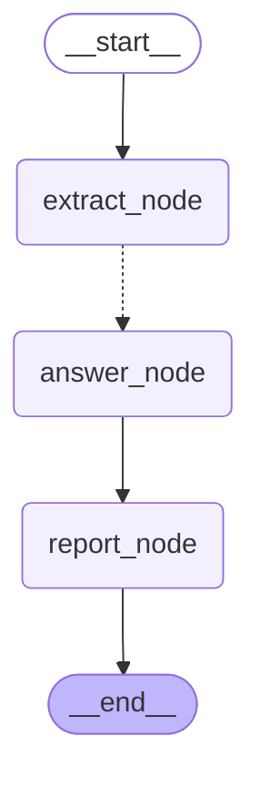

# RFP Answering Agent

Answers RFP and security questionnaires (Excel or PDF) from a knowledge base of company policy PDFs and past RFP answer spreadsheets.
Each question goes through a LangGraph subgraph: retrieve → draft with inline citations → check citations in code → LLM judge → redraft or hand off to a human.
The output is the original workbook with answers, sources, dropdown values and a status colour per row (red = not found/error, yellow = needs review).


**Stack:** Python 3.12, FastAPI, LangGraph, LangChain, Chroma, OpenAI (`gpt-4o-mini` default, `text-embedding-3-small`), LlamaParse for PDFs, LangSmith tracing (optional), React/TanStack frontend.

## Architecture

### RFP graph
`extract_node` reads questions (Excel: question/ID/dropdown column detection; PDF: LLM extraction into `ExtractedQuestion`), then fans out with `Send`, one `answer_node` per question (concurrency 5). Each `answer_node` runs the question subgraph inside one try/except, so a failing question becomes `status=error` instead of failing the whole run. `report_node` orders the `Answer` objects; `excel_io` writes them back to their original sheet and row.



### Question subgraph
Dotted arrows are router decisions. A "not found" draft skips validation and judge. Invalid citations or a judge rejection send the draft back with feedback, up to `MAX_REVISIONS = 2` (max 3 drafts); after that `give_up` keeps the last draft for a human. Every path runs the conflict audit and the dropdown classifier before `finalize` sets the status.


Both diagrams are generated from the compiled graphs with `get_graph().draw_mermaid()`.

## How it works

- **Retrieval.** Chroma, plain similarity search, k=5 (`RETRIEVAL_SEARCH_TYPE`; MMR stays selectable for comparison). The knowledge base mixes long policy PDFs with short past-RFP rows. `eval/retrieval_eval.py` checks, without LLM calls, whether the chunks holding each question's expected fact are retrieved: on the demo knowledge base similarity k=5 finds them for 44 of 46 questions, MMR (λ=0.7) for 40, with the same number of past-RFP rows (1.9 per question; EV-08's fact phrase was corrected to accept the Section 8 wording). MMR's diversity step dropped policy chunks ranked 4–5 in favour of less relevant ones.
- **Analyst draft.** A persona per category (Security/Tech/Product) writes an answer with inline `[Source: <label> (Page N | Row N)]` citations. The LLM returns `AnalystDraft` (a single `answer_text` field). Code builds the full `Answer` (IDs, sheet, row, sources, status), so the model can't change bookkeeping fields.
- **Citation validation in code.** `parse_citations` pulls the cited labels out, and `check_citations` compares them with the chunks that were actually retrieved. No citations, an unknown file or a location that wasn't retrieved → redraft with the list of allowed labels. No LLM involved.
- **LLM judge.** Sees the question, the retrieved context and the draft. It writes `reasoning` before `has_hallucination` and `feedback`. It is told how to read past-RFP rows ("Yes" supports the claim in that row's question, "No" contradicts it, guidance text is not evidence). Absence vs. inference rule: "the context does not specify X" is valid, while "X is implied to be 8" is a hallucination unless the context says so.
- **Redraft.** The analyst gets its previous answer plus the judge's feedback and is told to fix only the flagged claims. Supported content stays.
- **`needs_review` instead of discarding.** When revisions run out, the last draft is kept with a `review_note` (last judge feedback or invalid citations) and shows yellow. Before this change it was replaced by the "not found" message. Answers that are partly supported and partly "not found" are flagged the same way.
- **Not found, decided in code.** The draft also returns `answer_found`; when it is false, code replaces the text with the standard "not found" message (status `not_found`) and keeps the model's wording in the review note. gpt-6-luna often words a refusal freely instead ("X is not mentioned in the available information"), which used to pass as a normal answer. `finalize` therefore checks the answer, citations removed, against a short list of absence phrases ("not mentioned / stated / specified", "does not mention", "no information", …) and marks it `needs_review` with a note, so a human confirms. On eval set v2 every unanswerable question then reached a human; about two answers per run are flagged needlessly (a side caveat in a complete answer).
- **Status enum.** `answered | not_found | needs_review | error` is set by code in `finalize` and the error fallback. It drives the UI and Excel colours. A human edit in the UI sets `answered`.
- **Ingestion dedup.** Files are identified by filename and versioned by a SHA-256 of their bytes, stored in chunk metadata together with `chunk_count`. Same hash and complete → skip. Same hash but incomplete → re-ingest. New hash → ingest the new version first and delete the old chunks only after that succeeds, so a failed replace never loses the old version. Startup and upload use the same `ingest()`.

## Evaluation

### Demo knowledge base (LogistiComp)

**Eval set v2.** 52 questions written for the fictional documents (`eval/eval_set_v2.xlsx`), each with an expected answer, expected status, a type (answerable, nuanced, deduction, partial, stale/policy conflict, unanswerable, leak check, past-RFP only), a dev (33) / held-out (19) split and the reference document. 6 are unanswerable. `eval/score_report.py` scores unanswerable rows in code (100 only if the agent refuses), the rest with the LLM judge, and also counts wrongful refusals and leaks (other customers' names in answers, other customers' files in citations).

**Judge.** gpt-6-luna, reasoning effort low (an alias with no dated snapshot). It returns `reasoning`, then `generated_verdict` (the answer's own yes/no reply to the question), then a score; code caps the score at 20 when the verdict contradicts an expected Yes/No. Validated by re-judging the same stored answers with `eval/rejudge.py` instead of trusting one run: gpt-4o-mini filled the verdict with "agrees with expected" and produced 8 false caps on 52 answers, so it was dropped as judge; after clarifying the field, gpt-6-luna capped only real contradictions ("not within 6 months", "not 10"). Judging the same answers twice differed by 0.8 points overall (max 10 per row), well below the run-to-run noise of the agent.

**Retrieval.** `eval/retrieval_eval.py` checks, without LLM calls, whether the chunks holding each question's expected fact are retrieved. Switching from MMR (λ=0.7) to plain similarity k=5 raised fact recall from 40 to 44 of 46 answerable questions, with the same number of past-RFP rows per question.

**Current scores** (similarity k=5, judge gpt-6-luna; mean (min–max) over runs). Unanswerable rows count as handled if the agent marks them `not_found` or `needs_review`.

| Agent | Runs | Overall | dev | held-out | Unanswerable handled | Answerable flagged for review | Customer name in answer text | Cost / run |
|---|---|---|---|---|---|---|---|---|
| gpt-4o-mini | 2 | 87.3 (86.9–87.7) | 87.7 | 86.7 | 6/6 | 0 | 1 row in 1 of 2 runs | $0.048 |
| gpt-6-luna + absence safety net (default) | 1 | **89.9** | 90.6 | 88.7 | 6/6 (3 not_found, 3 needs_review) | 9 (6 expected partials, 1 useful, 2 false alarms) | 0 | $0.035 |

| Type (dev n / held-out n) | gpt-4o-mini dev / held-out | gpt-6-luna dev / held-out |
|---|---|---|
| answerable (6/5) | 95.0 / 85.0 | 92.5 / 72.0 |
| nuanced (5/3) | 84.0 / 68.3 | 81.0 / 81.7 |
| stale conflict (1/1) | 95.0 / 85.0 | 100 / 85.0 |
| deduction (5/3) | 82.5 / 100 | 96.0 / 100 |
| partial (4/2) | 96.2 / 77.5 | 92.5 / 97.5 |
| policy conflict (1/0) | 40.0 / – | 100 / – |
| unanswerable (4/2) | 100 / 100 | 100 / 100 |
| leak check (2/1) | 40.0 / 77.5 | 45.0 / 100 |
| past-RFP only (5/2) | 98.0 / 100 | 98.0 / 100 |

gpt-6-luna is the default: higher score, cheaper, no customer names in answers, and every unanswerable question reaches a human. Caveats: one gpt-6-luna run (run-to-run noise is a few points), and the gpt-4o-mini runs predate the absence safety net. Full log: [eval/RESULTS.md](eval/RESULTS.md).

### Original private knowledge base

*The numbers in this subsection were measured on the original private knowledge base and eval set, not on the LogistiComp demo data.*

**Method.** An eval set of 47 questions with expected answers. The evaluator runs the agent and has an LLM judge score each answer 0–100 against the expected one (dropdown columns are compared as exact category matches). Rows whose expected answer is "not found" are skipped, so n=33 are scored. A repeat run with nothing changed differed by ~5 points, so a setting is judged on the average of ≥2 runs, not on one run.

**Results.** Full run log: [eval/RESULTS.md](eval/RESULTS.md).
- Data mattered more than prompts. Adding two past-RFP answer spreadsheets to the 18 policy PDFs raised the score from 50.6 to 73.8; rows whose answer comes from those spreadsheets went from 27.2 to 72.5. It also exposed leaks: another customer's name was copied into an answer, and 20 citations named customer files. Safeguards are not implemented yet (see Roadmap).
- The answer-quality changes described in "How it works" (judge sees the question, reasoning before verdict, citation validation, `needs_review`, λ=0.7) averaged 74.1 over two runs against 71.5 before: +2.6, inside the ±5 noise. Individual wins repeated: the password-length question went from 0 to 90 in both runs.
- One prompt change looked neutral by score but was a regression; see "A flat score hiding a regression" below.

**Known limitations.**
- Expected answers are old agent outputs that nobody has reviewed (several rows are known to be wrong), so the score measures agreement with the agent's first version, not accuracy.
- Rows with an expected "not found" are skipped, so the evaluator can't see an agent that answers questions it shouldn't.
- One judge model, and the private eval set is small.

## Engineering notes

- **A docstring sent to the LLM.** A developer docstring on the Pydantic draft model became the JSON-schema description the model saw. On one question (password length), drafts over-claimed "minimum 8" in 26/26 runs with the docstring and 0/30 without it (runs interleaved). Fix: a comment instead of a docstring, plus snapshot tests over prompts and LLM-facing schemas (`tests/prompt_snapshots/`), so any byte change to what the model sees shows up in review.
- **Judge contradicting itself.** With the verdict field first, the judge flagged a supported claim as unsupported, and its feedback quoted the context text that supports it. Fix: a `reasoning` field before `has_hallucination`, so the verdict follows the analysis. After the change the same answer was approved.
- **MMR dropping the answer.** The password-length question kept failing. A retrieval diagnostic using the full question text showed the answer chunks at similarity ranks 3–4, removed by MMR λ=0.5 in favour of near-duplicate past-RFP rows. First fix: λ=0.7, checked offline first (both kinds of source returned), then in the eval, together with the judge changes: the question went from 0 to 90 in both runs. Later, on the demo knowledge base, a fact-recall check over the whole eval set (`eval/retrieval_eval.py`) showed MMR at λ=0.7 still dropping facts: similarity k=5 recall 44/46 vs MMR λ=0.7 40/46, at the same past-RFP count (after correcting EV-08's fact phrase). Retrieval now uses plain similarity.
- **A flat score hiding a regression.** A prompt change told the analyst to use the "not found" message only when nothing in the context was relevant. "Not found" answers fell from about 14 to 2 and the score stayed flat, which looked like a win. Checking the rows showed that about 10 of the 14 unanswerable questions now got padded partial answers. The score couldn't see it because the evaluator skips rows whose expected answer is "not found". Fix: reverted the prompt and handled partial answers in code (`is_partial_fail_text` → `needs_review` with a note). Scoring those rows is on the roadmap.

## Run it

### Run with Docker

Needs Docker Desktop and a root `.env` with `OPENAI_API_KEY` and `LLAMA_CLOUD_API_KEY` (`NAME=value` lines, no quotes).

```powershell
docker compose up --build   # frontend localhost:8080, backend localhost:8000 (/docs)
docker compose down         # stop
```

`Backend/data` and `Backend/chroma_db` are mounted from the host: new files in `data/` are ingested on startup, unchanged ones skipped. Don't run `start.bat` and compose at the same time (same ports, same Chroma store).

### Run locally

Windows, PowerShell, Python 3.12, Node.

```powershell
python -m venv venv; .\venv\Scripts\activate
pip install -r Backend/requirements.txt
cd Frontend; npm install; cd ..
# root .env: OPENAI_API_KEY, LLAMA_CLOUD_API_KEY
# optional LangSmith tracing: LANGSMITH_TRACING=true, LANGSMITH_API_KEY, LANGSMITH_PROJECT
#   LANGSMITH_ENDPOINT=https://eu.api.smith.langchain.com for EU accounts (must match the key's region)
#   (smoke.py, run_rfp.py, compare_excel.py switch tracing off)
.\start.bat                          # backend :8000, frontend :8080; ingests new files in Backend/data/ on startup
.\check.ps1                          # ruff (F rules) + pytest, no LLM or network calls
.\venv\Scripts\python eval\smoke.py --step 6   # real LLM calls (<$0.01) on eval/fail_test.xlsx, PASS/FAIL per eval/SMOKE.md
```

Other tools: `eval\run_rfp.py <file>` (any RFP through the pipeline, prints the agent log), `eval\compare_excel.py` (export vs. recorded baseline, cell by cell).

## Project layout

```
docker-compose.yml   backend + frontend services
Backend/Dockerfile   python:3.12-slim, uvicorn on :8000
Backend/app/
  main.py         FastAPI app, startup ingest, CORS
  api.py          endpoints (analyze, export edits, upload, evaluate)
  config.py       paths, retrieval params, FAIL_MSG, pricing (no side effects)
  store.py        lazy Chroma singleton
  ingestion.py    loaders + shared ingest() with hash dedup
  excel_io.py     column detection, dropdowns, read_sheets, formatted writer
  evaluation.py   LLM judge + categorical eval
  agent/
    prompts.py    all prompt builders (pinned by snapshot tests)
    schemas.py    pydantic models, Status enum, graph states
    nodes.py      node functions + routers
    graph.py      question subgraph, rfp graph
Backend/tests/    pytest: pure functions, citations, ingest dedup on a temp Chroma, prompt snapshots
eval/             eval set, smoke test, debug runner, Excel comparison, RESULTS.md
Frontend/src/components/   RfpSolver, KnowledgeBase, AccuracyEvaluator
Frontend/Dockerfile  node build → nginx; nginx.conf serves the SPA shell
docs/SPEC.md      design decisions with evidence, roadmap
```

## Roadmap

- **Eval:** first version vs. current over 3 runs (mean + spread); `eval/` lint in `check.ps1` and CI (it has its own ruff errors today); fix `eval/compare_excel.py` (its stub graph returns answers without sheet/row, so every stubbed case fails).
- **Chunking:** keep a section in one chunk and avoid intro-heavy chunks; EV-13 (hosting regions) is missed by every retriever because its sentence is split across chunks.
- **Past-RFP safeguards:** prompt rule against copying other customers' names or other questionnaires' numbering; neutral display names for past-RFP sources in context and citations; code check that flags known customer names as `needs_review`.
- **Judge model:** separate `JUDGE_MODEL` setting; A/B `gpt-4o-mini` against a stronger judge (it rejects valid absence statements inconsistently).
- **Judge rules:** allow direct deductions (e.g. 12 months ≥ 3 months), forbid speculation.
- **Citations:** claim-level check, meaning every factual sentence must carry a citation that supports it (absence statements excepted).
- **Agent:** Literal schema for dropdown values; validate conflict-audit snippets in code.
- **Ingestion:** skip past-RFP rows whose answer is a fail message; use real header rows for questionnaire columns.
- **Tests:** graph integration tests with mocked LLMs.
- **Infra:** streaming progress / background jobs, auth, Docker, configurable backend URL.
